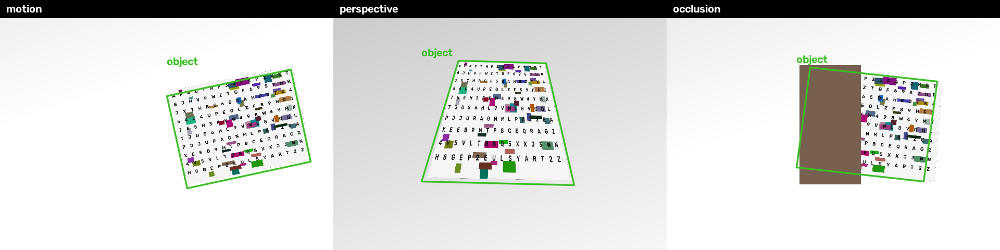

# Lab 2. Keypoint tracking of a planar object

The program tracks one flat object through a video. The first frame is a close-up of that object. On later frames, where the object is still visible, the program draws a quadrilateral on its boundary and a label.

## 1. Theoretical background

A flat object is a plane. A plane seen by a camera is related to a reference photo of the same plane by a homography \(H\), a \(3 \times 3\) matrix:

\[
\begin{bmatrix} x' \\ y' \\ w' \end{bmatrix}
= H
\begin{bmatrix} x \\ y \\ 1 \end{bmatrix}
\]

The pixel in the frame is \((x'/w',\ y'/w')\). \(H\) has eight degrees of freedom, so four point pairs determine it. The outline of the object is the four corners of the reference image, mapped by \(H\).

The point pairs come from keypoints. ORB finds FAST corners, assigns each corner an orientation, and describes it with a rotated BRIEF bit string. Two corners match when the Hamming distance between their descriptors is small. A match is kept only when the nearest descriptor is closer than \(0.75\) times the second nearest (Lowe's ratio test). Many of those matches still land on the background. RANSAC repeatedly fits \(H\) to four matches and keeps the fit with the most inliers, here matches that reproject within 4 pixels.

## 2. System description

`main.py` reads a video and writes a copy with the box drawn.

1. Frame 0 is the reference. ORB stores up to 2000 keypoints and their descriptors. Nothing is drawn on this frame.
2. On every later frame, ORB computes keypoints, the descriptors are matched to the reference with a Hamming k-nearest-neighbor matcher, and the ratio test drops ambiguous pairs.
3. `findHomography` estimates \(H\) with RANSAC. The four corners of the reference are projected into the frame.
4. The quadrilateral is rejected when it is not convex, flipped, too small, too large, or almost entirely outside the frame. A new lock also needs the inliers to cover at least 28% of the reference width and 18% of its height, so a handful of matches on a thin strip cannot throw the corners.
5. Each later frame is aligned to the reference with the enhanced correlation coefficient. The search starts from an affine warp, which stays stable from frame to frame, and is then refined to a homography so the outline can follow a tilt. The warp is scored against the reference picture itself, so the box cannot wander off onto the table the way a chain of tracked points can. A homography is kept only when it matches the reference better than the affine warp, its opposite sides differ by less than 2, and its area and corners stay close to the affine outline.
6. If the correlation is weak, or the outline would jump, ORB matches the frame to the reference and supplies a new warp. A full homography from those matches is kept only when its opposite sides differ by less than 1.8 and the corners stay inside the area the matches support. A jump of more than 45 pixels, or a large area change, is dropped unless the correlation is already strong, the match is confident, or the object was lost. Otherwise the last outline is kept for up to 8 frames. Small motion is blended with the previous outline so the box does not twitch.
7. The quadrilateral is drawn in green with the label above its top edge. The default label is `object`.

```bash
python3 -m venv .venv
.venv/bin/pip install -r requirements.txt
.venv/bin/python main.py video.mp4 --label magazine
```

The tracked video is written to `output/<name>_tracked.mp4`.

The reference must be the object alone, filling the frame. The object should be flat and covered in print or pictures. ORB has little to lock onto on a blank surface, and a cluttered background full of similar print produces matches that do not belong to the object.

`demo.py` builds three synthetic clips and runs the same tracker. Each clip is 640×480, 25 fps, 61 scene frames, and starts with the reference texture as frame 0.

- **motion** — translation and in-plane rotation on an empty background.
- **perspective** — scale change and a tilt that makes the rectangle a trapezoid.
- **occlusion** — a rectangle covers about 40% of the object, then the object slides out of the frame.

```bash
.venv/bin/python demo.py
```

## 3. Results



A frame counts as visible when at least 30% of the object area lies inside the frame and is not covered. IoU is the overlap of the predicted quadrilateral and the true one. The mean is taken over visible frames that received a box. A false box is a quadrilateral drawn when less than 12% of the object is visible.

| Clip | Visible frames | IoU ≥ 0.5 | Mean IoU | False boxes |
| --- | ---: | ---: | ---: | ---: |
| motion | 61 | 61 | 0.897 | 0 |
| perspective | 61 | 61 | 0.934 | 0 |
| occlusion | 48 | 47 | 0.883 | 0 |

On the first two clips every visible frame gets a box, and the box sits on the true boundary. The gap from 1 is the smoothed motion of the corners, rasterization of the warped texture, and H.264 compression of the clip before tracking. Perspective is higher than in-plane motion because the homography refinement follows the tilt.

In the third clip the box follows the full rectangle while a block covers part of it, including the hidden area. One visible frame is missed. After the object has left, the outline is removed without a box on the empty frames.

## 4. Conclusions

Aligning the frame to the reference with the enhanced correlation coefficient, then refining the outline to a homography, follows a flat textured object through translation, rotation, scale, and a moderate tilt. ORB supplies a new warp when that correlation is weak. The outline is the reference rectangle under the warp, so it stays on the object boundary instead of shrinking to the visible piece. Because every accepted warp is scored against the reference, the box does not walk off along a chain of points, and it is removed once both the correlation and the keypoints are lost.

The method needs texture on a plane. It will lose the object if the surface is blank, the frame is blurred, the view is no longer a single plane, or the background carries the same kind of print as the object.

## 5. Sources

1. Rublee E., Rabaud V., Konolige K., Bradski G. ORB: an efficient alternative to SIFT or SURF. ICCV, 2011.
2. Lowe D. G. Distinctive Image Features from Scale-Invariant Keypoints. International Journal of Computer Vision, 60(2), 2004.
3. Fischler M. A., Bolles R. C. Random Sample Consensus: A Paradigm for Model Fitting with Applications to Image Analysis and Automated Cartography. Communications of the ACM, 24(6), 1981.
4. Hartley R., Zisserman A. *Multiple View Geometry in Computer Vision*. Cambridge University Press. The homography induced by a plane.
5. Evangelidis G. D., Psarakis E. Z. Parametric Image Alignment Using Enhanced Correlation Coefficient Maximization. IEEE Transactions on Pattern Analysis and Machine Intelligence, 30(10), 2008.
6. OpenCV documentation. *Feature Matching + Homography to find Objects*. <https://docs.opencv.org/4.x/d1/de0/tutorial_py_feature_homography.html>
